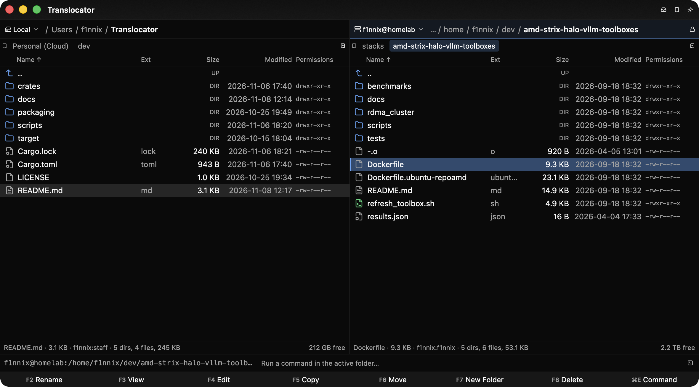

<h1 align="center">🗂️ Translocator</h1>

<p align="center">A dual-pane file manager for macOS and Linux.</p>

<p align="center">
  
</p>

## ✨ Features

- **Providers** — local disks, SSH servers ([read below](#-ssh-provider)), S3 accounts and WebDAV shares, any of them in either pane.
- **Bookmarks per host** — every server, every account and this machine keeps its own row of folders under the pane. ⌘D saves the one you are in, ⌘1 … ⌘9 jump.
- **Advanced file operations** — copy and move with per-item conflict resolution, queued in the background. Compare and synchronize two folders, multi-rename from masks, compress and extract, open archives as folders, view and edit a file that lives on a server.
- **Everything from the keyboard** — type to filter the list, mark with Space, find files, check permissions and sizes, open a command line or a terminal in the folder you are looking at.

## 🔐 SSH provider

### Why

A remote pane is usually SFTP, which can only move bytes: copying a folder from one directory to another on the same server means pulling it down and pushing it back up, `sudo` is out of reach, and nothing the machine already has can help.

SSH provider plugin runs **ordinary shell commands** over one multiplexed OpenSSH connection instead, so a remote pane behaves like a terminal on that machine — the server does the work, with your **own ssh setup** and nothing installed on the far end.

### How it works

- **Copies run on the server** — two folders on one host is one `cp -a` or `mv` there, however large; nothing crosses your network. Between two hosts it is a tar stream through this machine, with no temporary files.
- **sudo, per pane** — the lock button or ⌘⇧S. `sudo -n` where NOPASSWD is set, otherwise the password is asked once per connection, kept in memory and fed through `sudo -S`, never on a command line. A "Permission denied" anywhere offers the retry as root. Overwriting `/etc/nginx/nginx.conf` leaves it `root:root 0644`.
- **Your own ssh** — `~/.ssh/config`, keys, agent, jump hosts. Passwords, passphrases, 2FA codes and unknown host keys arrive as dialogs. One `ControlMaster` per bookmark, so no operation re-authenticates.
- **Any POSIX shell, any tools** — commands are short `sh` scripts behind an output marker, so a chatty `.bashrc` and a fish login shell are both fine, and GNU, BusyBox and BSD tools are detected and used as they are. An Alpine box works like a Debian one. No SFTP subsystem required.
- **Nothing is left running** — long jobs sit under a watchdog that kills the remote process group when you cancel, quit, or lose the connection.

Listings, `find`, chmod, chown, archives and multi-rename all work the same way: the server's own tools, one command per operation.

## 📦 Install

On **Linux**, take the `.deb` or `.rpm` from the [releases](https://github.com/f1nnix/Translocator/releases).

To build it yourself:

```bash
sudo scripts/linux-deps.sh build        # Linux, once; knows apt and dnf
cargo build --release -p translocator
```

```bash
scripts/bundle.sh --release             # macOS → target/release/Translocator.app
```

## 📄 License

MIT. See [LICENSE](LICENSE).
